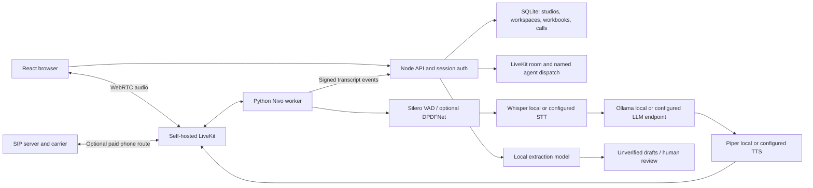

# Hosting Nivo and testing vendor voice

Research checked 22 September 2026. There is no paid account, public deployment or SIP carrier configured by this build.

Continuation verified23 September: persistent Raisina studio, real local speech-to-quotation extraction and browser microphone controls pass. Use [LOCAL_STUDIO.md](LOCAL_STUDIO.md) for the prepared local account and BOQ. Both Compose files pass configuration parsing; container builds and external deployment remain untested.

## The recommendation

Start on the existing Mac with an authenticated Nivo server, local LiveKit, a Python worker, and local models. Test browser conversations with people inside the business first. This has no model API or telephone-minute charge; it still consumes your hardware, power and bandwidth. For an external beta, use one persistent Linux VM and serve the frontend and API on the same HTTPS origin. Move the model process to a separate machine when latency or capacity requires it.

A permanently free, reliable, public multi-user service including outbound Indian phone calls is not a realistic promise. LiveKit is the media/agent transport. A telephone carrier still supplies the SIP trunk, caller number and paid connectivity to ordinary phone numbers. Account verification, supported Indian outbound routes and tariffs must be checked with the actual carrier before enabling calls.

| Option                       | Fit                                                 | Limits                                                                                                                                                                                                                                                                        |
| ---------------------------- | --------------------------------------------------- | ----------------------------------------------------------------------------------------------------------------------------------------------------------------------------------------------------------------------------------------------------------------------------- |
| Existing Mac/office computer | Free browser voice development and supervised tests | Must stay awake and online. Localhost works for microphone access; remote devices need trusted HTTPS and reachable WebRTC ports. A basic HTTP tunnel does not transport arbitrary WebRTC UDP.                                                                                 |
| Oracle Always Free VM        | Possible public backend + LiveKit trial             | Availability and tenancy limits vary; capacity can be unavailable and idle instances can be reclaimed. Current official documentation describes 2 OCPU/12 GB across free A1 instances, rather than assuming the historic 4/24 offer. CPU-only model latency must be measured. |
| Cloudflare Pages Free        | Optional static React frontend                      | Cannot host the persistent Python agent, SQLite disk, SIP or LiveKit media server. Separate API needs deliberate same-origin proxy/cookie configuration. The included deployment keeps app and API together instead.                                                          |
| Render Free web service      | Disposable HTTP demos                               | Sleeps after inactivity and loses local files on restarts/redeploys. Not suitable for this SQLite/file-storage deployment or persistent LiveKit media.                                                                                                                        |
| Paid small VM later          | Predictable always-on beta infrastructure           | Not purchased or provisioned. Size after measuring model inference and concurrent calls.                                                                                                                                                                                      |

Sources: [LiveKit deployment](https://docs.livekit.io/transport/self-hosting/deployment/), [ports and firewall](https://docs.livekit.io/transport/self-hosting/ports-firewall/), [Oracle free tier](https://docs.oracle.com/iaas/Content/FreeTier/freetier.htm), [Oracle Always Free conditions](https://docs.oracle.com/en-us/iaas/Content/FreeTier/freetier_topic-Always_Free_Resources.htm), [Cloudflare Pages limits](https://developers.cloudflare.com/pages/platform/limits/), [Render free-service limits](https://render.com/docs/free).

## Components and data path



Echo informed named dispatch, provider factories, VAD/endpointing, a per-call FrameProcessor and signed transcript delivery. No Echo credentials, commercial agent prompts, customer data, transfer systems or unrelated services were copied. DPDFNet is a distinct model, not DeepFilterNet. The Nivo adapter uses its current native-rate streaming API and retains burst output in a FIFO; it does not truncate enhanced samples to each incoming frame.

## Local setup

Use Node 22.22+ for the current dependency engine requirements and Python 3.12 or 3.13. The implementation was exercised on Node 22.14 with an engine warning from a transitive dependency; prefer the stated newer baseline when installing afresh.

```sh
npm ci
node scripts/configure-local.mjs
npm run build
npm run user:create -- you@example.com "Technosmart Interiors"
```

The configuration command creates random secrets in ignored `.env` and ignored `deploy/generated/` files, with private permissions. It refuses to overwrite existing configuration. On the development machine these files may already exist; preserve them. Account creation asks for a password in the terminal; no public signup endpoint exists. Each account owns a separate studio, with no shared-account roles in this beta.

Start the API and frontend in separate terminals:

```sh
npm run server
npm run dev
```

Visit `http://127.0.0.1:5178`. Sign in for server persistence. “Explore the local demo” uses the previous device-only data. To migrate it deliberately: export a full backup in local mode, sign in, and restore that backup in Settings. Restoring replaces the studio workspace and uploads the original workbooks.

Start LiveKit using either a native installation or Docker:

```sh
# macOS official installation
brew install livekit
livekit-server --config deploy/generated/livekit.yaml --bind 127.0.0.1 --node-ip 127.0.0.1
# Alternative when Docker is running:
docker compose -f compose.local.yaml up -d
```

See [LiveKit local installation](https://docs.livekit.io/transport/self-hosting/local/). The development configuration is loopback-only through the command/port mappings; do not expose it publicly.

Prepare local speech models:

```sh
python3 -m venv agent/.venv
agent/.venv/bin/pip install -r agent/requirements.txt
agent/.venv/bin/python -m agent.setup_models
```

Install [Ollama](https://ollama.com/download), start its local server with cloud features disabled, and fetch the model:

```sh
OLLAMA_NO_CLOUD=1 ollama serve
ollama pull qwen3:4b-instruct
```

The baseline is [Qwen3 4B Instruct](https://ollama.com/library/qwen3:4b-instruct), a roughly 2.5 GB quantized model. It is a starting point for local tests, not an assertion of vendor-price extraction accuracy. Model and voice files are excluded from Git. Piper's runtime is GPL-3.0; voice datasets/models have their own notices. Review the chosen voice's model card and distribution arrangements before packaging a commercial product. [Piper source](https://github.com/OHF-Voice/piper1-gpl), [Whisper implementation](https://github.com/SYSTRAN/faster-whisper), [Qwen model card](https://huggingface.co/Qwen/Qwen3-4B-Instruct-2507).

Start the voice worker:

```sh
agent/.venv/bin/python -m agent.worker dev
```

Open a saved enquiry with 1–20 selected BOQ items. “Test in browser” requires both LiveKit and worker health checks to pass. Allow microphone access and use headphones. The English local Piper voice does not establish Hindi/Hinglish readiness. A language-appropriate voice and recognition model must be selected and evaluated before real Indian vendor conversations. The optional Deepgram/ElevenLabs provider paths require your own accounts and may cost money.

## Audio settings

All parameters are server-side in `.env`; callers cannot override provider endpoints or secrets through room metadata.

| Setting                        | Baseline | Purpose                                                             |
| ------------------------------ | -------- | ------------------------------------------------------------------- |
| `VAD_THRESHOLD`                | 0.5      | Silero speech activation threshold                                  |
| `VAD_MIN_SPEECH`               | 0.15 s   | Minimum speech duration; test short Hindi replies before tuning     |
| `VAD_MIN_SILENCE`              | 0.5 s    | Silence needed for a VAD endpoint                                   |
| `VAD_PREFIX_PADDING`           | 0.3 s    | Preserve word onsets                                                |
| `ENDPOINT_MIN_SECONDS` / `MAX` | 0.5 / 3  | Endpoint timing bounds                                              |
| `INTERRUPTION_SECONDS`         | 0.5      | Speech duration before barge-in                                     |
| false interruption recovery    | 1.5 s    | Resume speech after a false interruption                            |
| preemptive generation          | off      | Conservative local CPU baseline                                     |
| `DPDFNET_ENABLED`              | false    | Enable and measure agent-side denoising; useful for SIP/noisy audio |
| `DPDFNET_MODEL`                | dpdfnet2 | Per-call CPU ONNX speech enhancement                                |
| `CALL_MAX_SECONDS`             | 300      | Backend and worker duration bound, max 900                          |

Browser capture also enables standard WebRTC echo cancellation and noise suppression. Avoid stacking multiple enhanced denoisers without measurement. LiveKit Cloud's enhanced cancellation models are not part of the self-hosted plan. See [noise cancellation](https://docs.livekit.io/transport/media/noise-cancellation/), [DPDFNet](https://github.com/ceva-ip/DPDFNet), [turn tuning](https://docs.livekit.io/agents/logic/turns/tuning/) and [self-hosted agents](https://docs.livekit.io/deploy/custom/deployments/).

The worker receives only a call UUID through dispatch metadata. It fetches the brief using HMAC authentication, excludes purchase costs from that brief, and sends signed idempotent transcript snapshots. Failed delivery is stored with private permissions in `data/agent-spool`; replay with `agent/.venv/bin/python -m agent.callbacks`. Monitor the spool and schedule replay in an actual deployment. Raw call recording is not enabled.

## Linux public beta

Use a persistent VM, an existing domain, and DNS A records for the app and LiveKit subdomains. Generate config as above, then set:

- `NODE_ENV=production`, `APP_DOMAIN`, `LIVEKIT_DOMAIN`.
- `APP_ORIGIN=https://your-app-domain`, `LIVEKIT_PUBLIC_URL=wss://your-livekit-domain`.
- Internal `LIVEKIT_URL=ws://127.0.0.1:7880` and `NIVO_API_URL=http://127.0.0.1:8787`.
- Real local/hosted model endpoints. Ollama is not bundled into the Linux compose file; run it on the host or point to a private inference server. Do not expose an unauthenticated model endpoint publicly.

```sh
docker compose -f compose.linux.yaml up -d --build
docker compose -f compose.linux.yaml exec app node --import tsx server/create-user.ts you@example.com "Your studio"
```

Compose includes app/frontend, SQLite persistent volume, Redis, LiveKit, worker, Caddy HTTPS, and opt-in SIP. It uses Linux host networking; it is not the macOS Compose profile. Prepare/download the model files and validate agent container health before inviting testers. The configuration has not been deployed to an external VM during this build.

Expose TCP 80/443 for Caddy, TCP 7881 and UDP 7882 for WebRTC, and UDP 3478 for TURN. Keep Redis 6379, app 8787, worker health 8081, model endpoints and LiveKit's internal 7880 blocked from the public internet. The supplied TURN configuration is UDP only. Restrictive enterprise/mobile networks may need TURN/TLS with its own certificate and reachable listener; implement the [official production deployment](https://docs.livekit.io/transport/self-hosting/deployment/) before claiming universal network compatibility. HTTPS alone does not solve media connectivity.

SQLite is one persistent server, not a multi-replica database. Stop and back up before schema migrations. Use `node --env-file=.env --import tsx scripts/backup-server.ts /private/backup/location` for a consistent SQLite snapshot including files and calls. Store an encrypted off-machine copy and rehearse restoration. See `BACKUP_AND_RECOVERY.md` for the validated restore-to-new-path command, container operations and tested refusal of existing destinations. Browser JSON backups cover workspace/workbooks, not account credentials, server audit history or call records.

## Enabling actual telephone calls later

1. Obtain a SIP carrier account with a verified caller number and supported Indian routes. No account was created by this build.
2. Configure the SIP service and firewall: SIP signaling 5060 TCP/UDP (restrict carrier IPs where possible), RTP 10000–20000 UDP. Set a tested `SIP_IMAGE` digest before production; the opt-in sample fallback is `livekit/sip:latest` because upstream publishes no release tags on GitHub.
3. Start only when configured: `docker compose -f compose.linux.yaml --profile telephony up -d sip`.
4. Set operator-only `SIP_ADDRESS`, `SIP_FROM_NUMBER`, optional `SIP_USERNAME`/`SIP_PASSWORD`; run `node --env-file=.env --import tsx scripts/register-trunk.ts`. This explicitly creates a trunk with your configured server, so it is not run by installation.
5. Save returned `LIVEKIT_SIP_TRUNK_ID`; keep `ENABLE_OUTBOUND_CALLS=false` until a supervised test with your own number succeeds.
6. Enable outbound only after confirming identity, rate collection behavior, stop/refusal handling, audio quality, caller-number presentation and quote accuracy. The UI asks for the vendor/number to be checked before dialing.

[LiveKit SIP self-hosting](https://docs.livekit.io/transport/self-hosting/sip-server/), [outbound calling](https://docs.livekit.io/telephony/making-calls/outbound-calls/).

## Beta acceptance

- Test create/import/edit/review/export and restoration with copies of typical BOQs.
- Verify a second account cannot read another studio's files/calls/workspace.
- Test two tabs saving conflicting revisions; pending changes must remain exportable.
- Use browser calls before PSTN. Check quiet/noisy environments, interruptions, short answers and dropped connections.
- Compare extracted draft amounts, units, tax basis and inclusions with the transcript. Never auto-apply drafts.
- Measure Hindi, English and mixed-language samples with your actual product names and rate formats.
- Check login, navigation, BOQ editing and voice controls on actual iOS Safari and Android Chrome. Automated Chromium sizes do not substitute for device testing.
- Establish operational retention, restore, privacy/contact and incident processes before a broader commercial launch.
